# Agent Copilot — AI operating layer for travel agents (independent prototype)

> **Disclaimer.** Independent portfolio/research prototype inspired by problems a B2B travel-tech platform could solve. It is **not** a TravClan system and uses **no** TravClan data, APIs, suppliers, prices or business rules. All hotels, activities, suppliers, customers and prices are **synthetic** (seeded generator in `backend/app/utils/datagen.py`).

Converts an unstructured customer requirement into validated, diverse recommendations, an itinerary and a margin-aware quotation. The agent stays in control; **deterministic code** owns pricing, margin, filtering and validation; an LLM (optional) is only for language.

```mermaid
flowchart LR
 A[Customer text] --> B[Extraction + confidence] --> C[Validation / clarification]
 C --> D[Hard filters] --> E[FAISS semantic retrieval] --> F[Weighted ranking] --> G[MMR diversity]
 G --> H[Itinerary planner] --> I[Pricing + margin] --> J[Constraint validator] --> K[Quote + versions] --> L[Agent review]
```



## Status (honest)
| Area | State |
|---|---|
| Synthetic data (544 hotels, 510 activities, 120 suppliers, 17 destinations, 1000 customers) | Done, deterministic |
| Extraction, intents, clarification | Done (rule-based; LLM layer is a stub) |
| Hard filters → FAISS → ranking → MMR, explanations | Done |
| Itinerary, pricing, margin, budget optimizer, validator, supplier health/risk | Done |
| Conversational modify (replace hotel, add/remove activity, relax, markup, discount) | Done (rule-based) |
| REST API (core endpoints) | Done |
| Tests | 37 passing |
| Evaluation harness | Done: extraction, diversity, violations, feasibility. **No** Recall/NDCG/MRR (needs human labels) |
| React frontend | **Done** — Vite + React app in `frontend/` with Copilot chat, recommendations, quote, itinerary, modify, destinations, suppliers |
| RAG, quote persistence/versioning in DB, feedback endpoint, `/evaluation` endpoints, LLM providers | Not yet |
| PostgreSQL / Docker | Written, **untested** (no Docker in the build sandbox); SQLite is the tested path |
| Real MiniLM embeddings | Supported if `sentence-transformers` is installed; tested path uses a hashed concept embedder |

## Run
```bash
pip install -r requirements.txt
python scripts/seed_database.py        # creates data/processed/copilot.db (SQLite)
python scripts/run_demo.py             # demo flow in the terminal
python scripts/run_evaluation.py       # offline evaluation (prints computed numbers)
cd backend && python -m pytest -q      # tests
uvicorn app.main:app --app-dir backend --reload   # API docs: http://localhost:8000/docs
# Docker + PostgreSQL:  docker compose up --build
```
Optional real embeddings: `pip install sentence-transformers` (needs internet to fetch `all-MiniLM-L6-v2`).

## Frontend
```bash
cd frontend
npm install
npm run dev          # http://localhost:5173  (proxies /api → localhost:8000)
npm run build        # production bundle → frontend/dist/
```
The UI has three pages accessible from the sidebar:
- **Copilot Chat** – type any trip brief and get extraction → recommendations → quote → itinerary all in one flow; use Modify panel for conversational edits.
- **Destinations** – visual grid of all 17 destinations.
- **Suppliers** – health score table with risk flags per supplier.

For a public deployment link, deploy the FastAPI backend to **Render** or **Railway** (see below) and set `VITE_API_URL=https://your-backend.onrender.com/api` in `frontend/.env.local` before building.

## Key design points
- **Hard vs soft:** destination, availability, min stars and hotel-cost ≤ 60% of budget are filters; everything else only affects ranking (`services/ranking/ranker.py`). Weights/limits live in `config/settings.py::RANKING`.
- **Score:** 0.30 semantic + 0.20 budget + 0.15 rating + 0.10 availability + 0.10 preference + 0.05 supplier + 0.05 location + 0.05 business (objective `customer|balanced|margin` shifts the business weight). Customer fit stays primary.
- **MMR:** `λ·relevance − (1−λ)·max_sim(selected)`, λ default 0.7, exposed per request.
- **Pricing:** supplier cost → markup → discount → 5% tax → total; margin = markup − discount. LLM never computes money.
- **Guardrails:** availability, prices, supplier data and margin come only from the DB/engine; missing availability is reported as "cannot be confirmed"; the validator flags (never hides) over-budget and supplier risk.

## API
`POST /api/requirements/extract|validate`, `POST /api/recommendations` (+`/rerank`), `POST /api/trip/start|modify`, `POST /api/itinerary/generate|optimize`, `POST /api/quote/generate|validate`, `GET /api/hotels|activities|destinations|suppliers`, `GET /api/suppliers/{id}/health`, `GET /health`.

## Productionization
Synthetic Postgres → internal warehouse; synthetic inventory → supplier APIs; FAISS → managed vector DB; synthetic pricing → real supplier pricing + business-configured margin rules; add auth/rate limiting (placeholders exist), enterprise LLM gateway, CRM integration.
